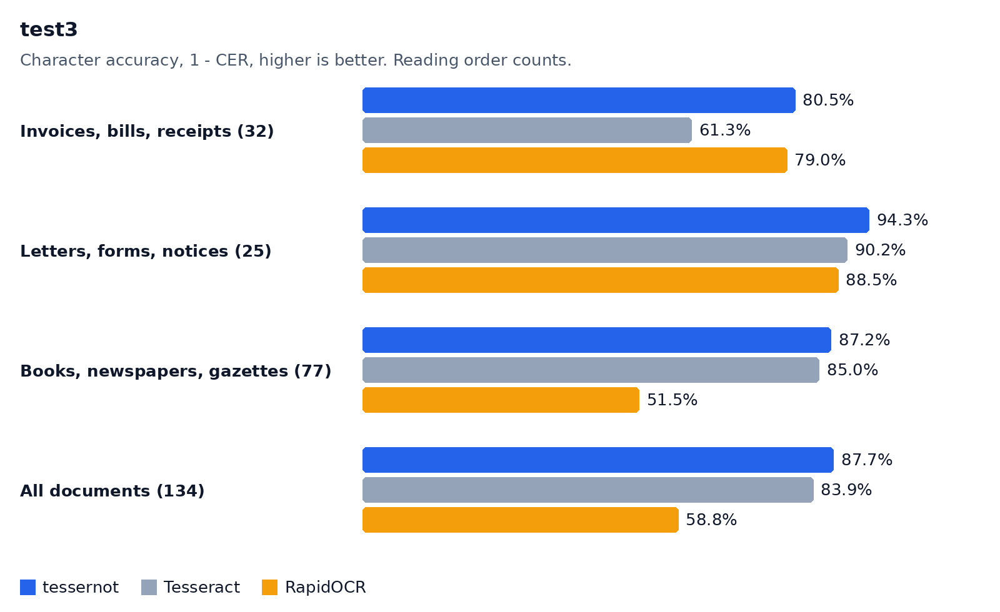

# tessernot

OCR for printed documents in pure Java, built on PaddleOCR's PP-OCR models. The engine is one JAR
with no runtime dependencies, and the models come in a second one. It needs no native libraries:
no JNI, no ONNX Runtime, no OpenCV and no Tesseract.

**Status: experimental.** It reads printed pages, invoices, receipts, typed letters and
multi-column pages. Its recognition matches the same models on ONNX Runtime and is ahead of
Tesseract, by a wide margin on invoices, receipts and photos. On the hardest historical pages
Tesseract still orders the text slightly better. See the [benchmark](#accuracy-and-speed).

## Why

- **It runs wherever a JVM runs.** There are no native libraries to ship per OS and CPU, no
  glibc/musl mismatch and no `java.library.path`.
- **It has its own inference runtime.** A small interpreter, written for these graphs, parses
  the official ONNX files, fuses the graph and runs it. It uses the Vector API when
  `jdk.incubator.vector` is available and falls back to scalar code that gives the same results
  when it is not.
- **It does more than return text.** You get line and word boxes with scores, reading order for
  multi-column pages, and tables as cells, ruled or set in columns. PDF input, in its own module, goes through Apache
  PDFBox. Output is plain text, JSON, hOCR, or a searchable PDF: the scan with its text under
  every word, to search, select and copy.

Expect 2–8 s per page on a laptop CPU, depending on how much text the page has; a dense
newspaper page with a hundred lines takes longest. Detection at 960 px instead of the default
2048 px (`--limit 960`) is about a quarter faster. It needs Java 21 and about 1 GB of heap at
the default, about 512 MB at 960 px; a multi-page PDF fits in the same heap, with fewer pages read
side by side when the heap is small. With less heap than the limit needs, the page is detected
at the largest size that fits, down to a heap of about 512 MB; below that the call fails with
a message that names the heap. Without the incubator module, the scalar path gives the same text about nine times slower
(twelve pages on eight cores: 398 s against 45 s).

## Quick start

You need Java 21 or newer. `./mvnw` downloads Maven 3.9; a Maven 3.9 of your own works as `mvn`.

```bash
./mvnw -DskipTests package
./ocr.sh ocr scan.jpg
./ocr.sh pdf document.pdf --dpi 150 --json
./ocr.sh pdf scan.pdf --searchable scan-with-text.pdf
./ocr.sh ocr scan.jpg --hocr scan.html
```

The default models are in `models/`. `./ocr.sh download models` fetches them again from
ModelScope and checks their SHA-256 digests.

| File | Role |
| --- | --- |
| `ch_PP-OCRv5_det_mobile.onnx` | text detection |
| `ch_PP-LCNet_x0_25_textline_ori_cls_mobile.onnx` | 0° / 180° line orientation |
| `PP-OCRv6_rec_small.onnx` + `ppocrv6_dict.txt` | recognition: Latin scripts including Polish, Chinese, Japanese kana, Greek |

`ocr.sh` runs `tessernot-cli/target/tessernot-cli.jar` with `--add-modules
jdk.incubator.vector`. That JAR bundles the models, so it also runs on its own, from any directory:
`java --add-modules jdk.incubator.vector -jar tessernot-cli.jar ocr scan.jpg`. Without the
flag, the engine uses the scalar path and the command line says so on stderr.

## Java API

The artifacts are on Maven Central under `io.github.kamilkrzywanski`; the engine and the default
models are enough to start. The models have a version of their own, which changes only when the
model files do; the engine checks the SHA-256 of every file it reads, not the version:

```xml
<dependency>
    <groupId>io.github.kamilkrzywanski</groupId>
    <artifactId>tessernot</artifactId>
    <version>0.1.1</version>
</dependency>
<dependency>
    <groupId>io.github.kamilkrzywanski</groupId>
    <artifactId>tessernot-models</artifactId>
    <version>0.1.0</version>
</dependency>
```

| Artifact | What it holds |
| --- | --- |
| `tessernot` | the engine, with no runtime dependencies |
| `tessernot-models` | the default models (27 MB), found on the class path by `OcrConfig.defaults()` |
| `tessernot-models-pl` | the word lists and Polish postal codes of `Corrections.POLISH` (12 MB) |
| `tessernot-pdf` | PDF input and searchable PDF output through Apache PDFBox |
| `tessernot-cli` | the command line; the runnable JAR with all of the above is attached to each [GitHub release](https://github.com/kamilkrzywanski/tessernot/releases), and JBang runs it from Maven Central: `jbang --java-options=--add-modules=jdk.incubator.vector io.github.kamilkrzywanski:tessernot-cli:0.1.1 ocr scan.jpg` |

```java
try (OcrEngine engine = OcrEngine.load()) {             // models from tessernot-models
    OcrResult result = engine.recognize(OcrImages.read(Path.of("scan.jpg")));
    String text = result.text();                  // page text in reading order
    for (TextLine line : result.lines()) {
        // line.text(), line.score(), line.detScore(), line.quad(), line.bounds()
        // line.words(): every word with its own box
    }
    for (TextTable table : result.tables()) {     // table.ruled(): a grid of rules, or columns with none
        List<List<String>> rows = table.cells();  // empty cell = ""
    }
    List<OcrResult> pages = OcrPdf.recognize(engine, Path.of("scan.pdf"), 150f);  // tessernot-pdf
    // The same scan, or an image, as a PDF with the text under every line:
    OcrPdf.searchable(engine, Path.of("scan.pdf"), Path.of("scan-with-text.pdf"), 150f);
}
```

The bundled models are read into memory; nothing is written to disk. To keep them out of your
artifact, leave out `tessernot-models`, fetch the files once with `ModelFiles.ensure(dir)` and use
`OcrEngine.load(dir)` or `OcrConfig.defaults(dir)`. The Polish rules look for their word lists next
to the models: in the same directory, or in `tessernot-models-pl`; without them the rules still run,
without the dictionary steps.

An engine is not meant for concurrent calls. For parallel requests, use a pool, which gives
each caller its own engine. The engines share the weights and word lists, which are loaded once,
and divide the thread count of the configuration between them, so four engines on twelve
processors run three threads each:

```java
try (OcrPool pool = OcrPool.open(4)) {
    OcrResult result = pool.recognize(image);
}
```

To change models or thresholds, start from `OcrConfig.defaults().toBuilder()`. For another
language, swap the recognition model and its dictionary (`recModel(Path)`, `dict(Path)`). If every page has one column, as with
receipts, `.layout(Layout.ROWS)` (`--layout rows`) reads row by row and skips the column analysis.
For Latin-script documents, `.alphabet(Alphabet.LATIN)` (`--alphabet latin`) keeps 2,440 of the
recognizer's 18,710 output classes: the same accuracy on the benchmark, and 8–18 % less time over
a benchmark set, up to a quarter on pages with a lot of text.

### Word lists in any language

A word list makes the recognizer prefer real words where the image allows it. Each list is a
UTF-8 file with one word per line, plain or gzip, in any order and case:

```java
OcrConfig config = OcrConfig.defaults().toBuilder()
        .wordList(Path.of("german.txt.gz"))
        .wordList(Path.of("my-product-names.txt"))
        .build();
```

On the command line: `--words german.txt.gz,names.txt`. A recognized word that no list holds is
searched again on the recognizer's own output for that word, and a listed word with the same
number of letters replaces it when the image supports that spelling almost as well (at most
e⁴ ≈ 55 times less likely). The recognizer often misses a mark on a letter, so one added mark per
word (`a`→`ą`, `u`→`ü`) is allowed even when the image shows little of it. Words already on a list,
numbers and letters glued to digits stay as read. There are no rules for any one language: a list
is only its words.

With the Polish and English lists of `tessernot-models-pl` as `--words`, and no other rule, word F1
rose from 0.930 to 0.945 on `test` (Polish pages 0.915 to 0.933) and from 0.956 to 0.963 on `dev`;
pooled CER on `test` went from 0.046 to 0.044. Searching costs under 1 % of a page's time; a large
list that is already sorted, lowercase and NFC loads in about half a second, any other is sorted
on load.
`test2` and `test3` have been scored with the lists only as part of the Polish profile (below).
`Corrections.POLISH` adds these two lists on its own.

### Fragments and the box threshold

A line of at most 10 characters whose mean character confidence is below 0.8 is left out, after
the reading order is found. These are mostly stamps, ornaments read as CJK characters and stray
marks. It goes with the detector's box threshold, 0.4 here where PP-OCR has 0.5: the lower
threshold finds lines of clean print the detector is only a little unsure of, and lets in more
of those marks. Together they took 7.8 % of the edits on `dev` and `test`, where they were
chosen, and 4 % of the group mean on the held-out `test3` (invoices and receipts 0.195 to 0.180,
books and newspapers unchanged). Dropping fragments also drops real short text the recognizer is
unsure of, such as an `X` in a check box or a misread page number: `.dropFragments(false)`
(`--keep-fragments`) keeps every line, and `.boxThresh(0.5f)` is the PP-OCR value.

### Public API

The public API is in `io.github.kamilkrzywanski.ocr`:

| Class | Role |
| --- | --- |
| `OcrEngine`, `OcrPool` | run OCR on images or on the pages of a document, one caller at a time or several in parallel |
| `OcrConfig`, `Corrections`, `Layout`, `Alphabet`, `DetLimit` | models, thresholds, threads, the optional Polish rules, automatic or row-by-row reading order, the characters the recognizer may output, and which side of the page the detection size limits |
| `OcrResult`, `TextLine`, `TextTable` | page text, lines with boxes and scores, tables |
| `OcrImages`, `OcrJson`, `OcrHocr` | read an image file (EXIF-aware), write the JSON and hOCR forms |
| `ModelFiles`, `ModelSource`, `ModelBundle` | download and check the default models; where a model file comes from; the interface of a model JAR |
| `OcrException` | the single exception type |

PDF input is `io.github.kamilkrzywanski.ocr.pdf.OcrPdf` in `tessernot-pdf`, and the command line is
`io.github.kamilkrzywanski.ocr.cli.Cli` in `tessernot-cli`.

Everything under `io.github.kamilkrzywanski.ocr.internal` (runtime, kernels, pre- and
post-processing) is public only for technical reasons. It may change in any release.

## Accuracy and speed

Public documents with references transcribed by hand, in Polish and English: invoices,
receipts, letters, forms, and multi-column books, dictionaries, newspapers and official
gazettes. `test3` (134 documents) and `test2` (37) are held out: nobody tunes on them and their
pages are not looked at. `test` (42) was scored once in an earlier round and then pointed at
what to fix. All three were scored on 2026-11-16, after every reference had been checked
against its picture again.



| Engine | `test3` CER pooled / median | `test3` word F1 | `test2` CER pooled / median | `test2` word F1 | `test` CER pooled / median | `test` word F1 |
| --- | ---: | ---: | ---: | ---: | ---: | ---: |
| **tessernot** | **0.123** / 0.033 | **0.885** | **0.084** / 0.048 | **0.954** | **0.041** / 0.022 | **0.941** |
| tessernot, `--limit 960` | 0.177 / 0.024 | 0.850 | 0.166 / 0.054 | 0.941 | 0.050 / 0.021 | 0.929 |
| tessernot, `--layout rows` | 0.408 / 0.046 | 0.885 | 0.536 / 0.151 | 0.954 | 0.387 / 0.099 | 0.941 |
| RapidOCR, same models on ONNX Runtime | 0.412 / 0.062 | 0.884 | 0.538 / 0.214 | 0.953 | 0.393 / 0.127 | 0.938 |
| Tesseract 5 (`pol` / `eng`) | 0.161 / 0.053 | 0.817 | 0.086 / 0.068 | 0.924 | 0.165 / 0.121 | 0.864 |

CER counts reading order; word F1 does not. `--layout rows` reads row by row like RapidOCR: it
matches the automatic layout on invoices and receipts and loses on everything with columns.
A page takes a few seconds: on an Intel i7-1365U laptop with 12 threads the median was 3.5 to
4.4 s for tessernot, 4.1 s for RapidOCR and 1.7 s for Tesseract (the benchmark notes have the
measurements and their caveats).

- **Invoices, bills and receipts:** 80 % character accuracy against 61 % for Tesseract on
  `test3`, 85 % against 52 % on `test2` and 88 % against 68 % on `test`. Tesseract returns
  nothing for some thermal and dot-matrix receipts.
- **Recognition:** word F1 is above Tesseract on every set and matches ONNX Runtime running the
  same models, so the pure-Java runtime gives up nothing.
- **Layout:** multi-column dictionaries, legal gazettes, the EU Official Journal, journal
  articles and newspapers with three or four narrow columns are read column by column, also
  where the detector merged lines across the gutters. RapidOCR reads the same models row by row
  and loses most of those pages.
- **Where Tesseract still wins:** the letters, forms and notices of `test2` (0.076 against
  0.133 for tessernot), which leave the two level on that set as a whole (0.086 against 0.084),
  and a few complex older pages, such as a 1910 magazine page, an 1836 gazette and a typed memo.
  It is faster.

Method, the `dev` set, per-document results and how to reproduce them are in
[docs/benchmark.md](docs/benchmark.md).

## Polish print corrections

`Corrections.POLISH` (`--corrections polish`) is an optional layer for Polish documents. It
adds:

- character swaps in CTC decoding (`ł`, `ó`, `Ś`, ...)
- the Polish and English word lists for the word-list search above, and a list of Polish
  postal codes
- second reads of a line crop for invoice details

The second reads and CTC swaps were tuned on three scans and checked on the `dev` set. With the
word-list search the profile gives word F1 0.957 on `dev`, 0.954 on `test`, 0.961 on `test2` and
0.911 on `test3`, against 0.948, 0.941, 0.953 and 0.884 for the plain pipeline. It is **off by
default**. See
[docs/corrections.md](docs/corrections.md) for the rules and what they get wrong.

## Not in scope

- handwriting
- tables without ruled lines that have two columns, two rows, or cells across columns: only
  rows set in three or more aligned columns become a table; the rest stays plain text, read row by row
- the flow of articles that jump between columns or pages, and ad collages (the columns
  themselves are read in order)

Vertical lines are rotated and read. A page that was scanned on its side or upside down is
turned before it is read, and a page scanned askew is turned level; the lines still come back in
the pixels of the picture as given, and `OcrResult.rotation()` tells the quarter turns.

## Documentation

- [docs/cli.md](docs/cli.md): commands, flags, JSON output
- [docs/internals.md](docs/internals.md): pipeline, runtime, kernels, concurrency
- [docs/corrections.md](docs/corrections.md): the Polish rules
- [docs/benchmark.md](docs/benchmark.md): the `dev` and `test` sets and how to reproduce the numbers

## License

The code is under the [Apache License 2.0](LICENSE). The models, word lists, test images and
benchmark documents come from third parties under their own licenses. See [NOTICE](NOTICE),
[models/NOTICE](models/NOTICE) and [bench/README.md](bench/README.md#licenses); the model JARs
carry these notices in `META-INF/models/`. `tessernot-pdf` depends on Apache PDFBox, and the runnable
JAR of `tessernot-cli` bundles it; the license and notice files of the bundled libraries are in its
`META-INF/third-party/`.
