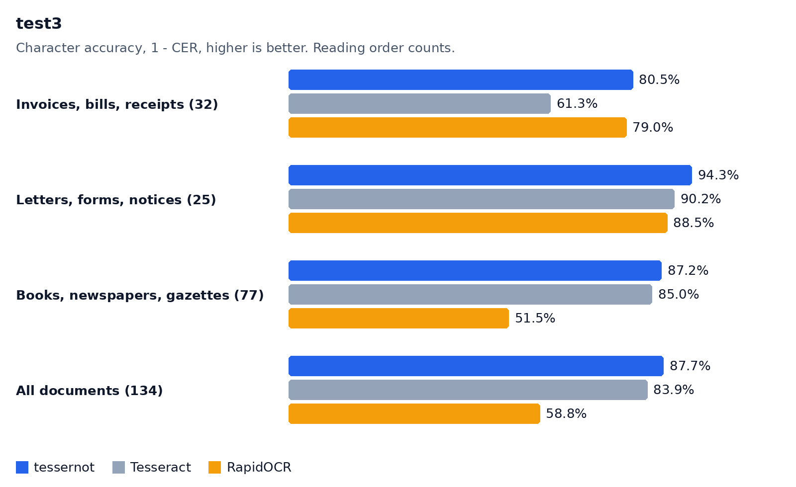
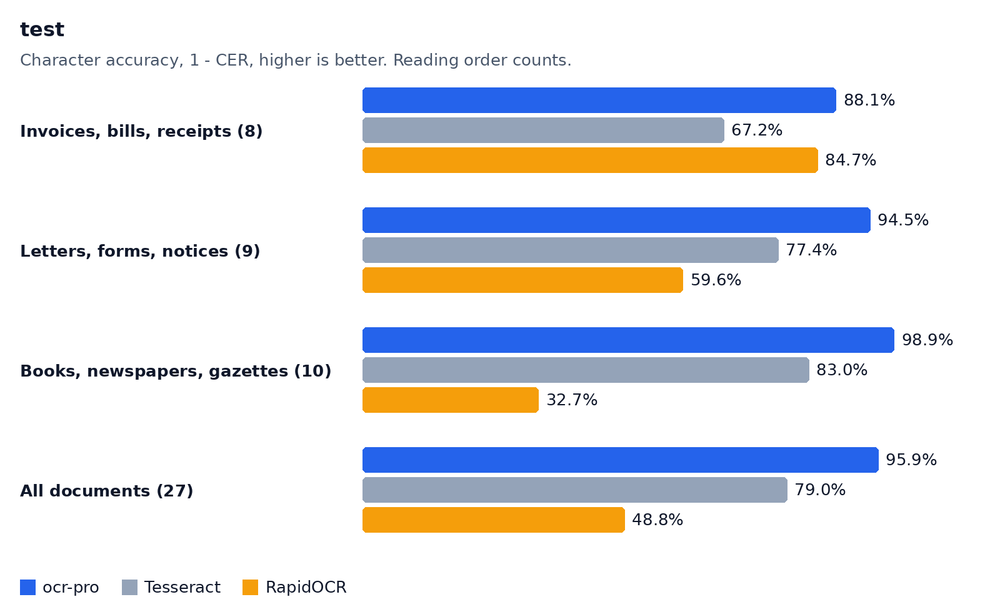
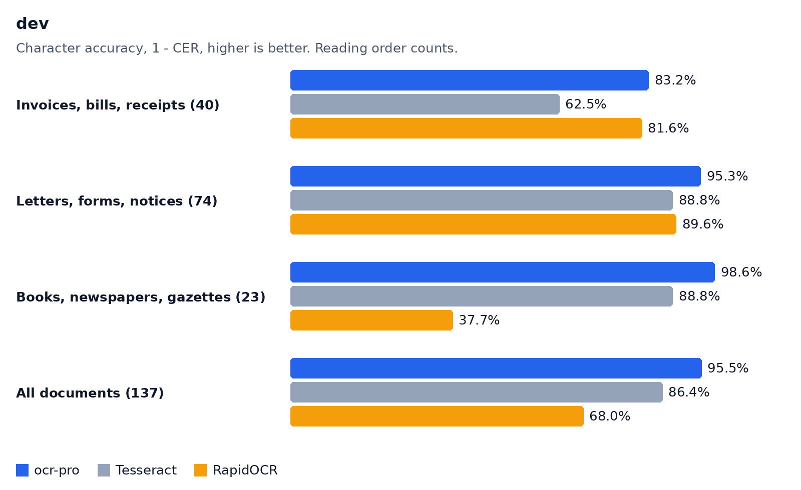

# Benchmark

The engine's rules and thresholds were first tuned on three scans
(`tessernot/src/test/resources/quality/`). Measuring on those scans only shows how well the rules fit
them. This benchmark uses public documents with references transcribed by hand, in four sets:

| Set | Documents | Role |
| --- | --- | --- |
| `dev` | 137 (73 PL, 64 EN), 249,926 characters | Used to find and fix problems: the first 20 documents, 16 multi-column pages added for the reading-order work, 3 Official Journal pages moved from `test3` on 2026-10-15, and 66 business documents (receipts, invoices, letters, memos, forms, notices) added in three batches on 2026-11-14 and 2026-11-15. Its numbers are **not independent**. |
| `test` | 42 (26 PL, 16 EN), 85,142 characters | Scored once, before the reading-order work. Its failures then pointed at what to fix, so it is **no longer independent** either. |
| `test2` | 37 (18 PL, 19 EN), 111,682 characters | Collected during the reading-order work, without looking at any engine output, and scored at the end; scored again after the column-gutter change, which was built on `dev` only (see below), and a third time on 2026-11-15 with the engine of that day, built on `dev` and `test` only. **The honest number.** Do not tune on it. |
| `test3` | 134 (67 PL, 67 EN), 296,478 characters | Collected without looking at any engine output and checked a second time against the images. Scored on 2026-11-14 to decide the box threshold and the dropping of fragments, and on 2026-11-15 with the engine of that day and the two other engines (see "Results on `test3`"); three of its pages had been scored by mistake on 2026-11-14. It is spent for tuning: do not tune on it. 77 of its pages are books, newspapers and gazettes, so its headline number is the mean of the three document groups. |

**58 business documents joined the sets on 2026-11-15** (receipts, invoices and accounts,
letters, forms, notices): 17 went to `dev`, 8 to `test`, 10 to `test2` and 23 to `test3`. They
were taken from 624 newly collected ones by a rule fixed beforehand (eight groups by kind and
language, the first of each in the order of a hash of the name, the sets dealt in a fixed
cycle), before any engine read them; each reference was then checked against its picture and
five pages were rejected. The held-out sets got most of them because they were thin in business
documents. As scored on the night of 2026-11-15 with the engine of that day and, for `test2`
and `test3`, with their references as corrected by the third check, pooled CER on the
documents each set had before and on the new ones:

| Set | tessernot, earlier documents | tessernot, new documents | Tesseract, earlier / new | RapidOCR, earlier / new |
| --- | --- | --- | --- | --- |
| `dev` | 0.049 (105) | 0.030 (17) | 0.146 / 0.080 | 0.389 / 0.043 |
| `test` | 0.041 (27) | 0.033 (8) | 0.198 / 0.085 | 0.514 / 0.142 |
| `test2` | 0.061 (20) | 0.200 (10) | 0.070 / 0.135 | 0.656 / 0.238 |
| `test3` | 0.129 (97) | 0.060 (23) | 0.158 / 0.113 | 0.478 / 0.053 |

The ten new documents of `test2` are the exception: tessernot reads them at 0.200, behind
Tesseract. Four of them are forms, and that group is where the set fell (see its table). They
have not been looked at; `test2` is not for tuning.

**42 more joined on 2026-11-16** by the same rule (14 to `dev`, 7 to `test`, 7 to `test2`, 14 to
`test3`; eight were rejected at the check), and a poster that the engine had read for a
diagnosis joined `dev`: the sets now have 137, 42, 37 and 134 documents.

**The references of forms were put into one reading order the same day.** Some of them read
cells by visual row in one place and each cell whole in another, so their CER measured the
collector's choices. The rule now says it in full (see "Transcription rules"): a line of the
reference is one printed row across the form. 24 forms were gone through against their
pictures, all 12 of the held-out sets among them, by checkers who saw no engine output; 17
files changed, in the order of words and the breaking of lines only, every word kept.

Every table below is for the sets as they now stand, scored on 2026-11-16 on the owner's word
with the engine of that day. Pooled CER on the documents each set had on 2026-11-15 and on the
43 that joined:

| Set | tessernot, earlier documents | tessernot, new documents | Tesseract, earlier / new | RapidOCR, earlier / new | tessernot on the earlier documents on 2026-11-15 |
| --- | --- | --- | --- | --- | --- |
| `dev` | 0.044 (122) | 0.059 (15) | 0.134 / 0.161 | 0.340 / 0.060 | 0.047 |
| `test` | 0.039 (35) | 0.052 (7) | 0.176 / 0.092 | 0.443 / 0.065 | 0.039 |
| `test2` | 0.087 (30) | 0.056 (7) | 0.085 / 0.095 | 0.579 / 0.145 | 0.087 |
| `test3` | 0.120 (120) | 0.190 (14) | 0.152 / 0.314 | 0.424 / 0.212 | 0.121 |

What moved on the earlier documents is the forms. On `dev` nine reordered forms carry all of
it, 767 edits fewer: the W-9 went from 0.139 to 0.066, FS-7311 from 0.064 to 0.024, the I-9
from 0.062 to 0.028, the W-4 from 0.045 to 0.021, and three went up (the KOWR form from 0.046
to 0.084, Navy 5512 from 0.022 to 0.040, the NEA budget from 0.015 to 0.023) where lines of
neighbouring cells stand half a line apart and the rule orders them by their tops. On `test`
nothing moved, on `test2` 14 edits. On `test3` the forms lost 208 edits (one summary form went
from 0.113 to 0.004) and the engine's one new rule, on lines boxed word by word, took 84 more
on one book page (0.103 to 0.045); it moved no other page of any set.

A caution that stays: in header bands of three type sizes and where cells step down like
stairs, whether two pieces stand on one row is decided by a pixel or two. The references are
now of one kind, but on such bands no engine can be right except by luck, so a form's CER
still carries noise there; its word F1 does not.

## Rules for using the sets

- **Find and fix on `dev`, report on a set nobody has tuned on.** A rule or threshold changed
  because of a failure in a test set turns that set into tuning data. The next round then needs
  new test documents, and the docs must say which documents were spent.
- **References come from the image only.** No OCR tool was run while transcribing. Wikisource
  pages, proofread by volunteers, and text layers of born-digital PDFs served as drafts and were
  rebuilt line by line against the image; where the print differs, the print wins.
- Disputed spots, and three references whose second check was not finished, are listed in the
  manifest notes. `test3` had its second check on 2026-10-15: 393 flagged spots, 61 corrections,
  and the two spots that stayed unclear are in its notes.
- **Report a set by document group when one kind dominates it.** `bench/report.py --manifest`
  adds the pooled CER of each group (invoices and receipts; letters, forms and notices; books,
  newspapers and gazettes) and their mean. For `test3` that mean is the headline number, so its
  77 pages of books, newspapers and gazettes do not drown its 15 invoices and receipts.

## The documents

`bench/manifest.tsv` lists every document with its source URL, SHA-256, license, author and
set. The page images and the PDF and DjVu originals of rendered pages are stored in
`bench/data/`, the submodule [tessernot-bench](https://github.com/kamilkrzywanski/tessernot-bench)
(`git submodule update --init bench/data`). `bench/fetch.sh` checks the digests and renders a page again when its image is
missing. The references are in `bench/ref/<set>/` and carry the same attribution.

| Kind | dev | test | test2 | test3 |
| --- | --- | --- | --- | --- |
| invoices, bills, receipts | 17 PL, 18 EN | 7 PL, 3 EN | 3 PL, 4 EN | 9 PL, 14 EN |
| letters, forms, notices | 33 PL, 27 EN | 7 PL, 5 EN | 3 PL, 3 EN | 7 PL, 5 EN |
| books, dictionaries, encyclopedias | 3 PL, 3 EN | 5 PL | 4 PL, 2 EN | 21 PL, 18 EN |
| newspapers, journals, papers | 5 PL, 5 EN | 3 EN | 2 PL, 3 EN | 10 PL, 16 EN |
| gazettes, official journals | 5 PL, 2 EN | 2 PL, 1 EN (other) | 1 PL, 2 EN | 6 PL, 6 EN |
| other | 1 EN | | | 2 PL tickets |

Most pages of books, newspapers and gazettes have two or more columns: dictionaries and
encyclopedias, the Official Journal of the EU, Dziennik Ustaw, 19th-century newspapers with three
or four columns, and journal articles with a full-width title and abstract.

### Transcription rules

- Exact characters as printed: case, diacritics, punctuation, and the document's own typos. A
  letter that is damaged in print or scan but still identifiable is written as that letter; a
  wrong letter is kept.
- **Reading order:**
  - running head first;
  - text on one visual row of a form or receipt is joined left to right. On a form this goes
    by the printed line, not by the cell: a cell of several lines is not read whole, each of
    its lines goes with the row it stands on (header cells too); two pieces are on one row
    when each overlaps more than half of the other's height, and lines of neighbouring cells
    that are not are lines of their own, in the order of their tops. Panels that stand apart,
    each in its own frame, are read one after another. Only running prose set in columns
    (five lines or more beside another such block) is read by column;
  - columns are read one after another, each top to bottom;
  - a title, heading, abstract or table across the columns closes one band of columns and
    starts the next; a figure across the columns does not, when the column text runs on below it;
  - footnotes and the page number where they are printed;
  - tables go row by row.
- Handwriting, signatures, rubber stamps, logos, illustrations and bleed-through are left out. An
  engine that reads them pays for the extra characters. All engines pay alike, but the absolute
  numbers go up.

### Metrics

Both texts are normalized first:

- NFC normalization;
- typographic quotes, apostrophes and dashes become ASCII;
- every run of whitespace becomes one space.

Two numbers are reported:

- **CER**: Levenshtein edits divided by the reference length. It depends on reading order: a page
  read in the wrong column order costs most of its characters.
- **Word F1**: reference and output words matched as multisets. It does not depend on order, so
  it measures recognition separately from layout.

"Pooled" figures sum the edits of all documents, so long pages weigh more. "Median" figures take
the median over documents.

## Engines

| Engine | Setup |
| --- | --- |
| **tessernot** | `OcrConfig.defaults` (`Corrections.NONE`, detection at 2048 px), 12 threads, Vector API on |
| **tessernot + polish** | the same with `--corrections polish` and the word lists from `models/` (see [corrections.md](corrections.md)) |
| **tessernot, fast** | the defaults with detection at 960 px (`--limit 960`) |
| **tessernot, rows** | the defaults with `--layout rows`: row by row, no layout analysis |
| **tessernot, Latin alphabet** | the defaults with `--alphabet latin`: the recognizer outputs only Latin-script characters |
| **RapidOCR** | rapidocr 3.10.0 on onnxruntime 1.31.0, running **the same ONNX files** with the same DB settings (limit 2048, threshold 0.35), see `bench/run-rapidocr.py` |
| **Tesseract** | 5.5.3 with `pol` or `eng` matching the document, default page segmentation, see `bench/run-tesseract.sh` |

Since 2026-11-14 a gray file is read with its samples as stored; before, the JDK's color
conversion brightened it (see "Reading an image" in [internals.md](internals.md)). Every table below
was scored after that change.

All engines ran on one laptop: Intel Core i7-1365U (2 performance + 8 efficiency cores,
12 threads), Linux, OpenJDK 21.0.12. The tables carry no page times: the engine of 2026-11-15 has not
been timed on an idle machine. The last times measured on one (2026-10-15) and those of the
morning of 2026-11-15 are under "Speed" in "What the numbers say". A page time is the median
over the documents of a set; what each engine's time includes is under [Reproduce](#reproduce).

Each set has two tables: one for the whole set, and one with the pooled CER of each document
group and the mean of the groups (`report.py --manifest`).

## Results on `test3`

Scored first on 2026-11-14, with the engine as it was that day and two settings of it: the
defaults until then (box threshold 0.5, fragments kept) and the defaults since (box threshold
0.4, fragments dropped). The second pair was chosen on `dev` and `test`, where it took 7.8 % of
the edits; `test3` was to say whether that holds. CER, lower is better:

| | Invoices, bills, receipts (15) | Letters, forms, notices (5) | Books, newspapers, gazettes (77) | Mean of the groups | Pooled |
| --- | --- | --- | --- | --- | --- |
| tessernot, defaults until 2026-11-14 | 0.1945 | 0.0807 | 0.1234 | 0.1329 | 0.1251 |
| tessernot, defaults since | 0.1798 | 0.0798 | 0.1232 | 0.1276 | 0.1244 |
| tessernot + polish, defaults until 2026-11-14 | 0.1915 | 0.0783 | 0.1185 | 0.1294 | 0.1203 |
| tessernot + polish, defaults since | 0.1765 | 0.0775 | 0.1182 | 0.1241 | 0.1196 |

It holds, and smaller than on the sets it was chosen on: business documents lose 7.6 % of their
errors, books and newspapers stay where they were, no group is worse. Of the 97 pages 20 read
better and 19 worse; the largest loss is 20 edits on a page that has 9,123.

### With the engine of 2026-11-16, 134 documents

Scored three times on the owner's word since: on the morning of 2026-11-15 the 97 documents it
then had, for the first time also with Tesseract, RapidOCR and the engine variants; that night
120, after its references had been checked a third time (180 lines corrected in `test2` and
`test3`, most on old Polish newspapers whose spelling had been modernised) and 23 business
documents had joined it; on 2026-11-16 all 134, after 14 more had joined and its seven forms
had been put into the one reading order. The tables are from 2026-11-16.



| Engine | CER pooled (pl / en / all) | CER median | Word F1 pooled (pl / en / all) |
| --- | --- | --- | --- |
| tessernot | 0.154 / 0.093 / 0.123 | 0.033 | 0.849 / 0.918 / 0.885 |
| tessernot + polish | 0.148 / 0.091 / 0.119 | 0.024 | 0.892 / 0.929 / 0.911 |
| tessernot, fast (960 px) | 0.215 / 0.138 / 0.177 | 0.024 | 0.799 / 0.895 / 0.850 |
| tessernot, rows (`--layout rows`) | 0.442 / 0.374 / 0.408 | 0.046 | 0.849 / 0.918 / 0.885 |
| tessernot, Latin alphabet (`--alphabet latin`) | 0.154 / 0.092 / 0.123 | 0.031 | 0.849 / 0.917 / 0.885 |
| RapidOCR (same models) | 0.448 / 0.377 / 0.412 | 0.062 | 0.845 / 0.918 / 0.884 |
| Tesseract 5 | 0.187 / 0.135 / 0.161 | 0.053 | 0.790 / 0.843 / 0.817 |

| Engine | Invoices, bills, receipts (32) | Letters, forms, notices (25) | Books, newspapers, gazettes (77) | Mean of groups |
| --- | --- | --- | --- | --- |
| tessernot | 0.195 | 0.057 | 0.128 | 0.127 |
| tessernot + polish | 0.193 | 0.056 | 0.123 | 0.124 |
| tessernot, fast (960 px) | 0.220 | 0.048 | 0.195 | 0.155 |
| tessernot, rows (`--layout rows`) | 0.195 | 0.107 | 0.483 | 0.262 |
| tessernot, Latin alphabet (`--alphabet latin`) | 0.194 | 0.057 | 0.127 | 0.126 |
| RapidOCR (same models) | 0.210 | 0.115 | 0.485 | 0.270 |
| Tesseract 5 | 0.387 | 0.098 | 0.150 | 0.212 |

The 14 documents that joined on 2026-11-16 read at 0.190 (Tesseract 0.314, RapidOCR 0.212);
with them the invoices, bills and receipts of the set went from 0.127 to 0.195. The 120 it had
stand at 0.120 (0.121 the night before).

The 97 earlier documents, in the order of the scorings: 0.1244 on 2026-11-14 (defaults since),
0.1297 on the morning of 2026-11-15 after the reading-order rules of that day, 0.1290 at night
with the corrected references. One page carries the step up: the Orzeł Biały of 1831 went
from 0.164 to 0.417 with the rules of 2026-11-15, 1,285 edits, and an Official Journal page of
2006 lost 170; 85 of the 97 pages read as before. That loss has not been traced: `test3` is not
for tuning, and a page like it has to be found for `dev` first. The corrected references moved
the pooled number little, because the pages they changed most (the Gazeta Polska of Chicago
1877 alone has 9,100 of the edits) lose theirs to reading order, not to letters.

## Results on `test2`

Scored on 2026-11-16, on the owner's word: 37 documents, the 30 it had on 2026-11-15 and 7
business documents that joined it. On the 30 nothing moved (0.087, Tesseract 0.085): its five
forms were gone through and two changed, by 14 edits together. The seven new ones read at
0.056 against Tesseract's 0.095, and with them the whole set is tessernot's by a hair, 0.084
against 0.086. That is no lead: letters, forms and notices are still Tesseract's here, 0.076
against 0.133, and the five forms read at 0.182 against 0.113.

History of the set: its first 20 documents stood at 0.079 before the changes of 2026-11-14 and
2026-11-15 and at 0.061 after them (Scientific American 1850 went from 0.085 to 0.011, the 1962
memo from 0.106 to 0.046), ahead of Tesseract (0.070); the ten business documents of
2026-11-15 read at 0.200 against Tesseract's 0.135.


| Engine | CER pooled (pl / en / all) | CER median | Word F1 pooled (pl / en / all) |
| --- | --- | --- | --- |
| tessernot | 0.063 / 0.098 / 0.084 | 0.048 | 0.927 / 0.969 / 0.954 |
| tessernot + polish | 0.061 / 0.098 / 0.083 | 0.048 | 0.941 / 0.972 / 0.961 |
| tessernot, fast (960 px) | 0.048 / 0.241 / 0.166 | 0.054 | 0.919 / 0.953 / 0.941 |
| tessernot, rows (`--layout rows`) | 0.507 / 0.554 / 0.536 | 0.151 | 0.927 / 0.969 / 0.954 |
| tessernot, Latin alphabet (`--alphabet latin`) | 0.063 / 0.098 / 0.084 | 0.048 | 0.927 / 0.969 / 0.954 |
| RapidOCR (same models) | 0.511 / 0.555 / 0.538 | 0.214 | 0.925 / 0.969 / 0.953 |
| Tesseract 5 | 0.079 / 0.090 / 0.086 | 0.068 | 0.911 / 0.931 / 0.924 |

| Engine | Invoices, bills, receipts (10) | Letters, forms, notices (13) | Books, newspapers, gazettes (14) | Mean of groups |
| --- | --- | --- | --- | --- |
| tessernot | 0.152 | 0.133 | 0.061 | 0.116 |
| tessernot + polish | 0.152 | 0.133 | 0.060 | 0.115 |
| tessernot, fast (960 px) | 0.162 | 0.145 | 0.173 | 0.160 |
| tessernot, rows (`--layout rows`) | 0.155 | 0.193 | 0.690 | 0.346 |
| tessernot, Latin alphabet (`--alphabet latin`) | 0.152 | 0.133 | 0.061 | 0.115 |
| RapidOCR (same models) | 0.174 | 0.191 | 0.693 | 0.353 |
| Tesseract 5 | 0.485 | 0.076 | 0.061 | 0.208 |

Per document, CER / word F1:

| Document | tessernot | fast | rows | RapidOCR | Tesseract |
| --- | --- | --- | --- | --- | --- |
| en-encyclopedia-eb1911-botticelli-p308 | 0.005 / 0.968 | 0.004 / 0.970 | 0.743 / 0.968 | 0.744 / 0.969 | 0.011 / 0.956 |
| en-encyclopedia-nsrw-1914-america-p60 | 0.024 / 0.982 | 0.032 / 0.986 | 0.746 / 0.982 | 0.746 / 0.983 | 0.035 / 0.971 |
| en-form-census-pr-2010 | 0.445 / 0.975 | 0.697 / 0.934 | 0.697 / 0.975 | 0.691 / 0.976 | 0.137 / 0.965 |
| en-form-usps-ps1583-2024 | 0.048 / 0.972 | 0.076 / 0.960 | 0.048 / 0.972 | 0.048 / 0.973 | 0.153 / 0.846 |
| en-gazette-london-gazette-1836-p41 | 0.644 / 0.930 | 0.691 / 0.918 | 0.706 / 0.930 | 0.706 / 0.944 | 0.504 / 0.903 |
| en-gazette-oj-l197-2012-p38 | 0.203 / 0.992 | 0.203 / 0.991 | 0.626 / 0.992 | 0.625 / 0.993 | 0.205 / 0.971 |
| en-invoice-beck-pauli-1890 | 0.115 / 0.864 | 0.278 / 0.744 | 0.151 / 0.864 | 0.202 / 0.802 | 0.480 / 0.389 |
| en-invoice-stafford-motor-1914 | 0.063 / 0.825 | 0.013 / 0.972 | 0.063 / 0.825 | 0.118 / 0.766 | 0.095 / 0.855 |
| en-invoice-watkins-cottrell-1906 | 0.145 / 0.770 | 0.158 / 0.785 | 0.145 / 0.770 | 0.214 / 0.749 | 0.425 / 0.365 |
| en-letter-jordan-dear-colleague-2026 | 0.035 / 0.982 | 0.035 / 0.987 | 0.035 / 0.982 | 0.027 / 0.980 | 0.078 / 0.948 |
| en-letter-luna-hfc-2025 | 0.063 / 0.989 | 0.062 / 0.994 | 0.018 / 0.989 | 0.018 / 0.996 | 0.017 / 0.987 |
| en-letter-pool-resources-1960 | 0.092 / 0.940 | 0.056 / 0.954 | 0.092 / 0.940 | 0.090 / 0.940 | 0.125 / 0.892 |
| en-magazine-crisis-1910-p13 | 0.207 / 0.972 | 0.209 / 0.964 | 0.703 / 0.972 | 0.703 / 0.977 | 0.011 / 0.969 |
| en-memo-nsam-125-1962 | 0.046 / 0.977 | 0.108 / 0.975 | 0.046 / 0.977 | 0.047 / 0.977 | 0.006 / 0.976 |
| en-newspaper-sciam-1850-p171 | 0.010 / 0.978 | 0.503 / 0.927 | 0.754 / 0.978 | 0.754 / 0.975 | 0.012 / 0.961 |
| en-paper-arxiv-writing-education-2025 | 0.022 / 0.980 | 0.021 / 0.979 | 0.477 / 0.980 | 0.483 / 0.980 | 0.020 / 0.981 |
| en-receipt-chin-meen-lae-2013 | 0.027 / 0.957 | 0.011 / 0.956 | 0.027 / 0.957 | 0.008 / 0.966 | 1.000 / 0.000 |
| en-receipt-tesco-finchley-1994 | 0.035 / 0.966 | 0.017 / 0.986 | 0.035 / 0.966 | 0.040 / 0.931 | 0.998 / 0.000 |
| en-receipt-vineyards-toll-2023 | 0.059 / 0.772 | 0.054 / 0.759 | 0.059 / 0.772 | 0.069 / 0.759 | 0.441 / 0.474 |
| pl-annales-sum-2023-wodoglowie | 0.052 / 0.993 | 0.002 / 0.993 | 0.698 / 0.997 | 0.699 / 0.999 | 0.001 / 0.998 |
| pl-dziennik-urzedowy-ue-c65-2006-s1 | 0.028 / 0.985 | 0.029 / 0.975 | 0.465 / 0.985 | 0.487 / 0.965 | 0.026 / 0.983 |
| pl-encyklopedya-rolnicza-1900-t9-s496 | 0.008 / 0.954 | 0.007 / 0.959 | 0.655 / 0.954 | 0.657 / 0.960 | 0.024 / 0.974 |
| pl-formularz-gus-rg-op | 0.077 / 0.959 | 0.059 / 0.917 | 0.053 / 0.959 | 0.053 / 0.965 | 0.068 / 0.913 |
| pl-formularz-pozwolenie-mw | 0.006 / 0.970 | 0.006 / 0.970 | 0.006 / 0.970 | 0.009 / 0.950 | 0.004 / 0.975 |
| pl-formularz-upowaznienie-kontrola | 0.105 / 0.982 | 0.101 / 0.976 | 0.472 / 0.982 | 0.471 / 0.980 | 0.101 / 0.963 |
| pl-kalendarz-ungra-1878-s101 | 0.037 / 0.813 | 0.106 / 0.814 | 0.758 / 0.802 | 0.757 / 0.801 | 0.025 / 0.898 |
| pl-list-kwartalnik-klasyczny-1930 | 0.024 / 0.966 | 0.017 / 0.963 | 0.024 / 0.966 | 0.024 / 0.972 | 0.009 / 0.974 |
| pl-obwieszczenie-maslon-1915 | 0.671 / 0.821 | 0.018 / 0.895 | 0.671 / 0.821 | 0.676 / 0.825 | 0.029 / 0.882 |
| pl-paragon-empik-2025 | 0.005 / 0.961 | 0.006 / 0.949 | 0.005 / 0.961 | 0.005 / 0.961 | 0.068 / 0.872 |
| pl-paragon-smyk-2025 | 0.005 / 0.970 | 0.005 / 0.970 | 0.005 / 0.970 | 0.007 / 0.960 | 0.091 / 0.740 |
| pl-pismo-mswia-olioc-2026 | 0.001 / 0.998 | 0.000 / 1.000 | 0.001 / 0.998 | 0.003 / 0.987 | 0.001 / 0.995 |
| pl-pismo-um-leszno-2026 | 0.117 / 0.927 | 0.120 / 0.916 | 0.117 / 0.927 | 0.120 / 0.920 | 0.178 / 0.638 |
| pl-przeglad-tygodniowy-1903-nr42 | 0.010 / 0.959 | 0.027 / 0.934 | 0.659 / 0.961 | 0.666 / 0.954 | 0.212 / 0.913 |
| pl-rachunek-dyskontowy-1935 | 0.681 / 0.914 | 0.681 / 0.857 | 0.681 / 0.914 | 0.682 / 0.914 | 0.807 / 0.586 |
| pl-rachunek-pluton-1934 | 0.065 / 0.863 | 0.056 / 0.872 | 0.065 / 0.863 | 0.071 / 0.837 | 0.433 / 0.585 |
| pl-slownik-esperancki-dreher-s18 | 0.076 / 0.584 | 0.079 / 0.562 | 0.738 / 0.581 | 0.741 / 0.568 | 0.050 / 0.748 |
| pl-wepi-1910-t43-s190 | 0.022 / 0.901 | 0.026 / 0.891 | 0.744 / 0.901 | 0.746 / 0.908 | 0.034 / 0.891 |

## Results on `test`

Scored on 2026-11-16: 42 documents, the 35 it had on 2026-11-15 (0.039, as then) and 7
business documents that joined it (0.052; a 1972 invoice at 0.245 carries most of it).

One reference of `test` was wrong until 2026-11-15. On page 42 of the Encyklopedja
staropolska a photograph is set across both columns and both columns run on below it; the
reference read the upper halves of the two columns, the caption, then the lower halves, which
cuts three sentences. The rules say a figure across the columns does not split them. With the
lines in the order of the columns tessernot read that page at 0.408 where it had scored 0.005,
because it too split the columns at the photograph, and the set stood at 0.054. The engine now
reads two columns through such a picture when both run on past it in the middle of a sentence
(reading order, step 9 in [internals.md](internals.md)); the page is back at 0.005 and the 27
documents at 0.041, this time against the right reference. Tesseract always read that page by
its columns: 0.036 against the corrected reference, 0.408 against the old one.



| Engine | CER pooled (pl / en / all) | CER median | Word F1 pooled (pl / en / all) |
| --- | --- | --- | --- |
| tessernot | 0.045 / 0.034 / 0.041 | 0.022 | 0.927 / 0.963 / 0.941 |
| tessernot + polish | 0.043 / 0.033 / 0.039 | 0.022 | 0.943 / 0.968 / 0.953 |
| tessernot, fast (960 px) | 0.055 / 0.041 / 0.050 | 0.021 | 0.912 / 0.956 / 0.929 |
| tessernot, rows (`--layout rows`) | 0.420 / 0.329 / 0.387 | 0.099 | 0.927 / 0.963 / 0.941 |
| tessernot, Latin alphabet (`--alphabet latin`) | 0.045 / 0.034 / 0.041 | 0.022 | 0.927 / 0.963 / 0.941 |
| RapidOCR (same models) | 0.423 / 0.341 / 0.393 | 0.127 | 0.925 / 0.959 / 0.938 |
| Tesseract 5 | 0.189 / 0.125 / 0.165 | 0.121 | 0.853 / 0.882 / 0.864 |

| Engine | Invoices, bills, receipts (12) | Letters, forms, notices (20) | Books, newspapers, gazettes (10) | Mean of groups |
| --- | --- | --- | --- | --- |
| tessernot | 0.119 | 0.041 | 0.011 | 0.057 |
| tessernot + polish | 0.117 | 0.041 | 0.008 | 0.055 |
| tessernot, fast (960 px) | 0.127 | 0.058 | 0.010 | 0.065 |
| tessernot, rows (`--layout rows`) | 0.123 | 0.238 | 0.676 | 0.346 |
| tessernot, Latin alphabet (`--alphabet latin`) | 0.119 | 0.041 | 0.011 | 0.057 |
| RapidOCR (same models) | 0.165 | 0.239 | 0.675 | 0.360 |
| Tesseract 5 | 0.322 | 0.134 | 0.147 | 0.201 |

Per document, CER / word F1:

| Document | tessernot | fast | rows | RapidOCR | Tesseract |
| --- | --- | --- | --- | --- | --- |
| en-bill-nb-telephone-1932 | 0.189 / 0.862 | 0.218 / 0.870 | 0.189 / 0.862 | 0.282 / 0.852 | 0.464 / 0.642 |
| en-form-bill-of-sale-reg135 | 0.008 / 0.991 | 0.011 / 0.972 | 0.008 / 0.991 | 0.014 / 0.996 | 0.039 / 0.924 |
| en-form-copyright-special | 0.005 / 0.981 | 0.004 / 0.983 | 0.005 / 0.981 | 0.008 / 0.981 | 0.035 / 0.928 |
| en-form-loc-nls | 0.027 / 0.998 | 0.004 / 0.993 | 0.027 / 0.998 | 0.004 / 0.998 | 0.020 / 0.974 |
| en-form-msha-2000-7 | 0.050 / 0.996 | 0.114 / 0.964 | 0.236 / 0.996 | 0.242 / 0.997 | 0.130 / 0.897 |
| en-invoice-bell-howell-1972 | 0.245 / 0.735 | 0.338 / 0.695 | 0.243 / 0.735 | 0.473 / 0.694 | 0.337 / 0.483 |
| en-invoice-red-cross-new-york-1919 | 0.107 / 0.913 | 0.016 / 0.921 | 0.107 / 0.913 | 0.119 / 0.909 | 0.242 / 0.680 |
| en-journal-nature-1896-p419 | 0.022 / 0.995 | 0.022 / 0.995 | 0.659 / 0.995 | 0.614 / 0.962 | 0.429 / 0.949 |
| en-letter-dhs-noem-harvard-2025 | 0.009 / 0.992 | 0.007 / 0.997 | 0.009 / 0.992 | 0.007 / 0.993 | 0.015 / 0.981 |
| en-letter-wyden-nokings-2025 | 0.008 / 0.992 | 0.006 / 0.994 | 0.008 / 0.992 | 0.008 / 0.996 | 0.009 / 0.988 |
| en-magazine-outing-v45-developers | 0.001 / 0.995 | 0.001 / 0.995 | 0.715 / 0.995 | 0.712 / 0.996 | 0.003 / 0.991 |
| en-memo-conference-president-1954 | 0.077 / 0.947 | 0.077 / 0.942 | 0.077 / 0.947 | 0.082 / 0.940 | 0.051 / 0.939 |
| en-newspaper-aparri-news-1900 | 0.014 / 0.931 | 0.013 / 0.935 | 0.746 / 0.931 | 0.750 / 0.925 | 0.197 / 0.774 |
| en-poster-coalbrookdale-auction-1910 | 0.022 / 0.978 | 0.020 / 0.948 | 0.022 / 0.978 | 0.082 / 0.974 | 0.075 / 0.861 |
| en-programme-toledo-symphony-1921 | 0.086 / 0.844 | 0.087 / 0.853 | 0.086 / 0.844 | 0.136 / 0.853 | 0.136 / 0.778 |
| en-receipt-fanzz-2002 | 0.014 / 0.931 | 0.014 / 0.939 | 0.014 / 0.931 | 0.014 / 0.940 | 1.000 / 0.000 |
| pl-biblia-wujek-1923-s296 | 0.007 / 0.962 | 0.008 / 0.963 | 0.753 / 0.957 | 0.753 / 0.966 | 0.434 / 0.972 |
| pl-cennik-nr7-poznan-1937-s67 | 0.167 / 0.630 | 0.179 / 0.649 | 0.167 / 0.630 | 0.237 / 0.611 | 0.313 / 0.429 |
| pl-dziennik-ustaw-1952-s374 | 0.019 / 0.888 | 0.026 / 0.878 | 0.751 / 0.888 | 0.750 / 0.879 | 0.057 / 0.845 |
| pl-dziennik-ustaw-1994-s302 | 0.002 / 0.995 | 0.002 / 0.995 | 0.727 / 0.995 | 0.732 / 0.994 | 0.001 / 0.991 |
| pl-encyklopedja-staropolska-1900-s42 | 0.005 / 0.962 | 0.007 / 0.951 | 0.752 / 0.962 | 0.752 / 0.967 | 0.036 / 0.981 |
| pl-faktura-pge-specyfikacja-2019 | 0.132 / 0.869 | 0.131 / 0.782 | 0.126 / 0.869 | 0.159 / 0.855 | 0.273 / 0.594 |
| pl-formularz-gus-rg-of | 0.091 / 0.962 | 0.094 / 0.932 | 0.091 / 0.962 | 0.046 / 0.961 | 0.061 / 0.923 |
| pl-formularz-szczepienie-psa | 0.012 / 0.965 | 0.021 / 0.950 | 0.393 / 0.965 | 0.400 / 0.963 | 0.118 / 0.921 |
| pl-list-zabawa-victoria-1912 | 0.127 / 0.848 | 0.120 / 0.835 | 0.127 / 0.848 | 0.180 / 0.812 | 0.071 / 0.667 |
| pl-obwieszczenie-stan-wojenny-1981 | 0.075 / 0.899 | 0.129 / 0.836 | 0.649 / 0.899 | 0.619 / 0.919 | 0.493 / 0.849 |
| pl-obwieszczenie-starosta-ostrow-mazowiecka-2025 | 0.001 / 0.995 | 0.001 / 0.995 | 0.001 / 0.995 | 0.028 / 0.977 | 0.001 / 0.998 |
| pl-obwieszczenie-starosta-police-2023 | 0.026 / 0.976 | 0.018 / 0.987 | 0.019 / 0.976 | 0.031 / 0.982 | 0.027 / 0.967 |
| pl-odezwa-zhp-lodz-1935 | 0.017 / 0.969 | 0.029 / 0.957 | 0.768 / 0.969 | 0.768 / 0.967 | 0.009 / 0.967 |
| pl-paragon-castorama-2021 | 0.021 / 0.857 | 0.043 / 0.792 | 0.021 / 0.857 | 0.024 / 0.842 | 0.137 / 0.748 |
| pl-paragon-inmedio-2024 | 0.033 / 0.831 | 0.035 / 0.821 | 0.033 / 0.831 | 0.041 / 0.800 | 0.149 / 0.495 |
| pl-pismo-msz-ambasada-palestyny-2010 | 0.111 / 0.920 | 0.097 / 0.927 | 0.111 / 0.920 | 0.142 / 0.903 | 0.105 / 0.819 |
| pl-pismo-prok-lomza-strona-2026 | 0.014 / 0.878 | 0.014 / 0.878 | 0.014 / 0.878 | 0.017 / 0.857 | 0.124 / 0.887 |
| pl-pismo-umwp-2026 | 0.007 / 0.990 | 0.010 / 0.962 | 0.007 / 0.990 | 0.007 / 0.990 | 0.013 / 0.975 |
| pl-rachunek-bursa-ludowa-przemysl-1911 | 0.023 / 0.945 | 0.048 / 0.940 | 0.023 / 0.945 | 0.022 / 0.941 | 0.475 / 0.551 |
| pl-rachunek-hurtownia-slupsk-1948 | 0.152 / 0.821 | 0.305 / 0.768 | 0.152 / 0.821 | 0.246 / 0.810 | 0.683 / 0.612 |
| pl-rachunek-mennica-1931 | 0.444 / 0.785 | 0.442 / 0.757 | 0.444 / 0.785 | 0.490 / 0.758 | 0.683 / 0.489 |
| pl-rachunek-wola-1927 | 0.042 / 0.942 | 0.039 / 0.954 | 0.042 / 0.942 | 0.060 / 0.931 | 0.187 / 0.700 |
| pl-slownik-staropolski-arct-s479 | 0.050 / 0.884 | 0.011 / 0.906 | 0.726 / 0.884 | 0.724 / 0.893 | 0.726 / 0.571 |
| pl-slownik-uczonych-zydow-1905-s11 | 0.009 / 0.961 | 0.010 / 0.971 | 0.009 / 0.961 | 0.010 / 0.957 | 0.010 / 0.980 |
| pl-statut-zhp-1936-s8 | 0.014 / 0.903 | 0.011 / 0.914 | 0.014 / 0.903 | 0.037 / 0.930 | 0.024 / 0.910 |
| pl-zaliczka-wspolnota-bialystok-2023 | 0.017 / 0.905 | 0.017 / 0.905 | 0.046 / 0.905 | 0.054 / 0.902 | 0.159 / 0.701 |

## Results on `dev`

Scored on 2026-11-16: 137 documents. 98 of them are business documents added since
2026-11-14, which is why the pooled CER is higher than the 0.023 this table showed for the
first 39 documents. The 122 it had on 2026-11-15 read at 0.044 (0.047 then; the difference is
its nine reordered forms), the 15 that joined on 2026-11-16 at 0.059: two invoices of 1863 and
1949 at 0.32 and 0.36, and a letter of 2026 at 0.194 that Tesseract reads at 0.023.



| Engine | CER pooled (pl / en / all) | CER median | Word F1 pooled (pl / en / all) |
| --- | --- | --- | --- |
| tessernot | 0.049 / 0.041 / 0.045 | 0.033 | 0.927 / 0.961 / 0.946 |
| tessernot + polish | 0.046 / 0.041 / 0.043 | 0.031 | 0.943 / 0.964 / 0.955 |
| tessernot, fast (960 px) | 0.087 / 0.063 / 0.075 | 0.047 | 0.909 / 0.949 / 0.932 |
| tessernot, rows (`--layout rows`) | 0.271 / 0.340 / 0.307 | 0.070 | 0.927 / 0.961 / 0.946 |
| tessernot, Latin alphabet (`--alphabet latin`) | 0.048 / 0.041 / 0.044 | 0.033 | 0.927 / 0.961 / 0.946 |
| RapidOCR (same models) | 0.285 / 0.352 / 0.320 | 0.096 | 0.916 / 0.954 / 0.937 |
| Tesseract 5 | 0.116 / 0.154 / 0.136 | 0.101 | 0.878 / 0.894 / 0.886 |

| Engine | Invoices, bills, receipts (40) | Letters, forms, notices (74) | Books, newspapers, gazettes (23) | Mean of groups |
| --- | --- | --- | --- | --- |
| tessernot | 0.168 | 0.047 | 0.014 | 0.076 |
| tessernot + polish | 0.165 | 0.045 | 0.013 | 0.075 |
| tessernot, fast (960 px) | 0.158 | 0.066 | 0.067 | 0.097 |
| tessernot, rows (`--layout rows`) | 0.173 | 0.081 | 0.622 | 0.292 |
| tessernot, Latin alphabet (`--alphabet latin`) | 0.168 | 0.046 | 0.014 | 0.076 |
| RapidOCR (same models) | 0.184 | 0.104 | 0.623 | 0.304 |
| Tesseract 5 | 0.375 | 0.112 | 0.112 | 0.200 |

## What changed in this round

1. **Reading order** (see [internals.md](internals.md#reading-order)). Text columns are found
   before blank rows split the page, a page is split into three or more columns one gutter at a
   time, a skewed photo is turned level before the analysis, and a line the detector merged
   across a narrow gutter is cut there and read again.
2. **Detection at 2048 px instead of 960 px.** Small print, dense columns and thermal receipts
   lost lines at 960 px. The fast setting keeps 960 px.
3. **Numbers are never a column**, and **`Layout.ROWS`** turns the layout analysis off. This
   came after `test2` was first scored: the Smyk receipt there had its item lines read as a
   column (CER 0.166). The rule was built and checked on the Castorama receipt in `test`, whose
   totals had the same fault (0.061 to 0.020), but the Smyk number on `test2` is no longer a clean
   measurement. Before this change, `test2` gave tessernot a pooled CER of 0.123 and a median of
   0.068, and 90 % on invoices and receipts.
4. **Column gutters found in the ink** (`InkGutters`), built on the `dev` newspapers. The detector
   often merges lines of neighboring columns into one box, and on a page with three or four
   narrow columns too many lines are merged for the box geometry to show the gutter. The engine
   now looks inside every box for blank strips wider than a word space, keeps the ones that line
   up down the page next to column margins (lines that end and start there), and cuts the merged
   lines at each such gutter, also across three columns at once. A second rule keeps a box that
   lies above another one out of its row: on a curved photo the boxes of neighboring lines
   overlap vertically. On `dev`: Wisła 1912 0.528 to 0.024, The Independent 1898 0.754 to 0.009,
   the Bristol Mercury photo 0.290 to 0.075 (Tesseract 0.243); pooled CER 0.134 to 0.023.
   `test2` was scored again after this change. Nothing in it was tuned on `test2`, but its
   per-document numbers had been read when the previous run was reported, so take the gain there
   as a check that the rule carries over, not as a fresh measurement: Scientific American 1850
   0.264 to 0.085, the 1878 calendar 0.174 to 0.038, pooled CER 0.122 to 0.079, no page worse.

On `test`, scored before this round, the pooled CER of tessernot fell from 0.214 to 0.046 and the
median from 0.087 to 0.025. Examples: the Bible page 0.433 to 0.007, the 1952 Dziennik Ustaw 0.453
to 0.026, Arct's dictionary 0.735 to 0.048, the 1981 poster photo 0.669 to 0.095.

## What changed on 2026-11-14 and 2026-11-15

Everything here was built on `dev` and `test`; `test2` and `test3` were not looked at. The
first `test3` table above was scored in the middle of it, for the first item, and both sets were
scored with the finished engine on 2026-11-15.

1. **New defaults:** box threshold 0.4, and short lines the recognizer is unsure of are left
   out (see "Results on `test3`").
2. **Pages are set right before they are read** (see "Turning the page" in
   [internals.md](internals.md)): a page on its side or upside down is turned, a page askew by up
   to 45 degrees is levelled, a page photographed from the side, whose lines run to a point,
   is laid flat, a small page with small print is enlarged, and a
   picture too large for the heap is read smaller. A long line is shown to the orientation
   classifier by its middle; squeezed whole, it was now and then read upside down.
3. **Blocks side by side** (steps 7 and 8 of "Reading order"): they are columns only where
   they stand beside each other, and two small blocks whose lines share baselines are the
   cells of rows. A line is cut at a gutter the boxes suggest only when the ink does not deny
   the gutter.
4. **Sixty-six business documents** joined `dev`: receipts, invoices, letters, memos, forms and
   notices. They are what item 3 was built on, and why `dev` is now harder than `test`.

On `test` the pooled CER of tessernot went from 0.046 to 0.041 and with the Polish profile from
0.044 to 0.038; on the first 39 documents of `dev` from 0.023 to 0.018. Pages that are not
upright, level and flat when given gain far more than these sets show, since nearly all of their
pages are: every page of `dev` and `test` turned by a quarter or a half reads as it does
upright, where four sample pages went from 94 edits to over 2,200 before.

On the two sets nobody tuned on, the same changes moved one newspaper page each, in opposite
directions: `test2` went from 0.079 to 0.062 (Scientific American 1850), `test3` from 0.124 to
0.130 (the Orzeł Biały of 1831). The rest of both sets moved by 140 edits for the better on
`test2` and 15 for the worse on `test3`.

## What the numbers say

- **Recognition is the strongest part.** Word F1, which ignores order, is above Tesseract on every
  set (0.954 against 0.924 on `test2`, 0.885 against 0.817 on `test3`) and matches RapidOCR, which runs the same models on ONNX
  Runtime.
- **Invoices, bills and receipts favor tessernot by a wide margin.** Its character accuracy on
  them is 85 % against 52 % for Tesseract on `test2`, 80 % against 61 % on `test3`, 88 % against
  68 % on `test` and 83 % against 62 % on the 40 of `dev`; Tesseract returns nothing for a 1994
  Tesco receipt. Letters, forms and notices: 94 % against 90 % on `test3`, 96 % against 87 % on
  `test`, 95 % against 89 % on `dev`, but 87 % against 92 % on the thirteen of `test2`.
- **Reading order is far ahead of RapidOCR**, which reads the same models row by row: pooled CER
  0.084 against 0.538 on `test2`, 0.123 against 0.412 on `test3`. `--layout rows` gives the same row
  order inside tessernot (0.536);
  on invoices and receipts it equals the automatic layout, and everywhere else it loses.
- **Why RapidOCR first scored higher on a few business documents** (on `test2` its invoices and
  receipts reached 92 % against 90 %): it has no layout analysis, and on a single-column receipt
  plain row order is the right answer. tessernot's column detection fired falsely on the Smyk
  receipt: it took the item lines for a column and read them before the shop's header (CER 0.166
  against 0.007). There was no heuristic to borrow from RapidOCR; the fix was to make the column
  detection refuse columns of numbers, and to offer `--layout rows` for one-column streams.
- **Tesseract and `test2`.** The two are level on this set: 0.084 against 0.086 on its 37
  documents, 0.087 against 0.085 on the 30 it had on 2026-11-15. tessernot is far ahead on its
  invoices and receipts (0.152 against 0.485), level on books, newspapers and gazettes (0.061)
  and behind on letters, forms and notices (0.133 against 0.076), so the mean of the groups is
  0.116 against 0.208. On `test3` tessernot is ahead in every group (0.123 against 0.161
  pooled, 0.127 against 0.212 as the mean of the groups). Where tessernot loses on the older
  pages of `test2`: The Crisis 1910 (0.207 against 0.011), the London Gazette 1836 (both fail,
  0.644 against 0.504), a journal article (0.052 against 0.001), a 1962 memo (0.046 against
  0.006) and the 1878 calendar (0.037 against 0.025). These pages are spent: a fix based on
  them needs new test documents.
- **Detection at 2048 px wins on every set**, by a wide margin on English pages of `test2` (0.098
  against 0.241 at 960 px), but not on its Polish pages (0.063 against 0.048 at 960 px, on
  eighteen pages). 960 px is the fast setting.
- **Row order is no longer better on business documents.** On the invoices and receipts of
  `dev` the layout analysis and `--layout rows` are level (0.168 and 0.173), and on its letters,
  forms and notices the analysis is at 0.047 against 0.081; before the rules of 2026-11-15 rows
  won on fourteen of its 66 business documents.
- **Speed.** Measured on 2026-10-15 on an idle machine (`dev` then had 39 documents), median
  page time on `test2` / `test` / `dev`: tessernot 6.7 / 3.7 / 3.5 s, RapidOCR on ONNX Runtime
  with the same models 5.2 / 3.7 / 3.7 s, Tesseract 3.5 / 1.5 / 1.8 s. Dense newspaper pages
  with a hundred lines and more take longest (Scientific American 1850: 19.6 s).
  `--limit 960` takes 15–31 % less time (5.7 / 2.6 / 2.4 s). `--alphabet latin` takes 8–18 %
  less time over a whole set, up to a quarter on pages with a lot of text, at the same accuracy.
  Repeated runs vary by about ±20 %, so treat the times as an order of magnitude.
- **Speed of the engine of 2026-11-15.** Measured that morning on `test` / `dev` (105
  documents), one engine at a time, while another session ran short jobs on the machine:
  tessernot 3.5 / 4.4 s, `--limit 960` 2.7 / 2.5 s, `--alphabet latin` 3.2 / 3.7 s, RapidOCR
  4.1 / 4.1 s, Tesseract 1.7 / 1.7 s. On the 39 documents `dev` had in October: tessernot 4.8 s
  against 3.5 s then, RapidOCR 4.3 against 3.7, Tesseract 2.0 against 1.8. The two other
  engines were 9–16 % slower than in October on the same pages, which is what the machine
  cost that morning; what remains of tessernot's 37 % is the price of the steps added since
  (small print enlarged, a page turned level and detected again), and on `test` no such price
  shows (3.5 s against 3.7). The slowest page is the Congressional Record of 2008 (19.8 s).
  The accuracy of these runs is the accuracy in the tables, document by document.

## Reproduce

```bash
./mvnw -DskipTests package
# The images are in the submodule bench/data: git submodule update --init bench/data.
# bench/fetch.sh rebuilds a missing one from its source
# (curl; pdftoppm for PDF; ddjvu and pnmtopng, ImageMagick or Pillow for DjVu).

./ocr.sh score bench/ref/test2 bench/data --out bench/out/test2-plain > bench/out/test2-plain.tsv
./ocr.sh score bench/ref/test2 bench/data --corrections polish --out bench/out/test2-polish > bench/out/test2-polish.tsv
./ocr.sh score bench/ref/test2 bench/data --limit 960 --out bench/out/test2-fast > bench/out/test2-fast.tsv

pip install rapidocr==3.10.0 onnxruntime==1.31.0
python bench/run-rapidocr.py bench/ref/test2 bench/data bench/out/test2-rapidocr models > bench/out/test2-rapidocr-times.tsv
./ocr.sh score bench/ref/test2 --hyp bench/out/test2-rapidocr > bench/out/test2-rapidocr.tsv

bench/run-tesseract.sh bench/ref/test2 bench/data bench/out/test2-tesseract > bench/out/test2-tesseract-times.tsv
./ocr.sh score bench/ref/test2 --hyp bench/out/test2-tesseract > bench/out/test2-tesseract.tsv

python3 bench/report.py "tessernot=bench/out/test2-plain.tsv" "Tesseract=bench/out/test2-tesseract.tsv:bench/out/test2-tesseract-times.tsv"
python3 bench/chart.py docs/benchmark-test2.png "test2" bench/manifest.tsv "tessernot=bench/out/test2-plain.tsv" "Tesseract=bench/out/test2-tesseract.tsv" "RapidOCR=bench/out/test2-rapidocr.tsv"
```

Replace `test2` with `test`, `dev` or `test3` for the other sets.

- `score` prints one row per document (characters, CER, word F1, ms), then totals per name prefix
  (`pl`, `en`) and overall.
- Times from `score` exclude image decoding and include one warm-up page.
- The RapidOCR script times its call after a warm-up.
- The Tesseract script times the whole process.
- `report.py` turns score files into the tables above; `chart.py` draws the chart (Pillow).
