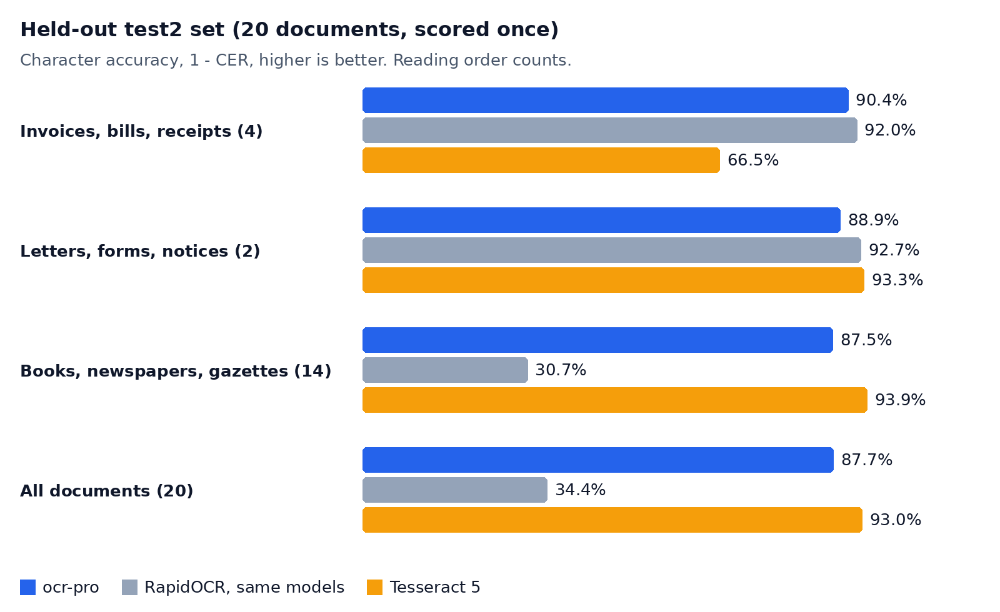

# Benchmark

The engine's rules and thresholds were first tuned on three scans
(`src/test/resources/quality/`). Measuring on those scans only shows how well the rules fit
them. This benchmark uses public documents with references transcribed by hand, in four sets:

| Set | Documents | Role |
| --- | --- | --- |
| `dev` | 39 (21 PL, 18 EN), 110,882 characters | Used to find and fix problems: the first 20 documents, 16 multi-column pages added for the reading-order work, and 3 Official Journal pages moved from `test3` on 2026-10-15. Its numbers are **not independent**. The `dev` results below were computed on the first 36. |
| `test` | 27 (18 PL, 9 EN), 59,772 characters | Scored once, before the reading-order work. Its failures then pointed at what to fix, so it is **no longer independent** either. |
| `test2` | 20 (10 PL, 10 EN), 82,338 characters | Collected during the reading-order work, without looking at any engine output, and scored at the end; scored again after the column-gutter change, which was built on `dev` only (see below). **The honest number.** Do not tune on it. |
| `test3` | 97 (47 PL, 50 EN), 245,601 characters | Held out for a later round. Collected without looking at any engine output, checked a second time against the images, and not scored. `test2` stays the scored set. Do not tune on it. 77 of its pages are books, newspapers and gazettes, so its headline number is the mean of the three document groups (see below). |

## Rules for using the sets

- **Find and fix on `dev`, report on a set nobody has tuned on.** A rule or threshold changed
  because of a failure in a test set turns that set into tuning data. The next round then needs
  new test documents, and the docs must say which documents were spent.
- **References come from the image only.** No OCR tool was run while transcribing. Wikisource
  pages, proofread by volunteers, and text layers of born-digital PDFs served as drafts and were
  rebuilt line by line against the image; where the print differs, the print wins.
- Disputed spots, and three references whose second check was not finished, are listed in the
  manifest notes. `test3` had its second check on 2026-10-15: 393 flagged spots, 61 corrections,
  and the two spots that stayed unclear are in its notes.
- **Report a set by document group when one kind dominates it.** `bench/report.py --manifest`
  adds the pooled CER of each group (invoices and receipts; letters, forms and notices; books,
  newspapers and gazettes) and their mean. For `test3` that mean is the headline number, so its
  31 book pages do not drown its 15 invoices and receipts.

## The documents

`bench/manifest.tsv` lists every document with its source URL, SHA-256, license, author and
set. The page images and the PDF and DjVu originals of rendered pages are stored in
`bench/data/`, the submodule [ocr-pro-bench](https://github.com/kamilkrzywanski/ocr-pro-bench)
(`git submodule update --init bench/data`). `bench/fetch.sh` checks the digests and renders a page again when its image is
missing. The references are in `bench/ref/<set>/` and carry the same attribution.

| Kind | dev | test | test2 | test3 |
| --- | --- | --- | --- | --- |
| invoices, bills, receipts | 3 PL, 3 EN | 6 PL, 2 EN | 2 PL, 2 EN | 6 PL, 9 EN |
| letters, forms, notices | 5 PL, 5 EN | 4 PL, 4 EN | 1 PL, 1 EN | 2 PL, 1 EN |
| books, dictionaries, encyclopedias | 3 PL, 3 EN | 5 PL | 4 PL, 2 EN | 21 PL, 18 EN |
| newspapers, journals, papers | 5 PL, 5 EN | 3 EN | 2 PL, 3 EN | 10 PL, 16 EN |
| gazettes, official journals | 5 PL, 2 EN | 2 PL, 1 EN (other) | 1 PL, 2 EN | 6 PL, 6 EN |
| other | | | | 2 PL tickets |

Most pages of books, newspapers and gazettes have two or more columns: dictionaries and
encyclopedias, the Official Journal of the EU, Dziennik Ustaw, 19th-century newspapers with three
or four columns, and journal articles with a full-width title and abstract.

### Transcription rules

- Exact characters as printed: case, diacritics, punctuation, and the document's own typos. A
  letter that is damaged in print or scan but still identifiable is written as that letter; a
  wrong letter is kept.
- **Reading order:**
  - running head first;
  - text on one visual row of a form or receipt is joined left to right;
  - columns are read one after another, each top to bottom;
  - a title, heading, abstract or table across the columns closes one band of columns and
    starts the next; a figure across the columns does not, when the column text runs on below it;
  - footnotes and the page number where they are printed;
  - tables go row by row.
- Handwriting, signatures, rubber stamps, logos, illustrations and bleed-through are left out. An
  engine that reads them pays for the extra characters. All engines pay alike, but the absolute
  numbers go up.

### Metrics

Both texts are normalized first:

- NFC normalization;
- typographic quotes, apostrophes and dashes become ASCII;
- every run of whitespace becomes one space.

Two numbers are reported:

- **CER**: Levenshtein edits divided by the reference length. It depends on reading order: a page
  read in the wrong column order costs most of its characters.
- **Word F1**: reference and output words matched as multisets. It does not depend on order, so
  it measures recognition separately from layout.

"Pooled" figures sum the edits of all documents, so long pages weigh more. "Median" figures take
the median over documents.

## Engines

| Engine | Setup |
| --- | --- |
| **ocr-pro** | `OcrConfig.defaults` (`Corrections.NONE`, detection at 2048 px), 12 threads, Vector API on |
| **ocr-pro + polish** | the same with `--corrections polish` and the word lists from `models/` |
| **ocr-pro, fast** | the defaults with detection at 960 px (`--limit 960`) |
| **ocr-pro, rows** | the defaults with `--layout rows`: row by row, no layout analysis |
| **RapidOCR** | rapidocr 3.10.0 on onnxruntime 1.31.0, running **the same ONNX files** with the same DB settings (limit 2048, threshold 0.35), see `bench/run-rapidocr.py` |
| **Tesseract** | 5.5.3 with `pol` or `eng` matching the document, default page segmentation, see `bench/run-tesseract.sh` |

All engines ran on one laptop: Intel Core i7-1365U (2 performance + 8 efficiency cores,
12 threads), Linux, OpenJDK 21.0.12. RapidOCR and Tesseract were measured on 2026-10-13. The
accuracy of ocr-pro comes from a run on 2026-10-14 after the last change below. That run shared
the processor with another heavy job, so its times are not used: the ocr-pro times are from the
run just before the column-gutter change (item 4 below), which adds only a second read of the
lines it cuts. The machine was busier on the second day, so compare times within one engine
only.

## Results on `test2`



| Engine | CER pooled (pl / en / all) | CER median | Word F1 pooled (pl / en / all) | Median page time |
| --- | --- | --- | --- | --- |
| ocr-pro | 0.031 / 0.107 / 0.079 | 0.033 | 0.912 / 0.970 / 0.951 | 8.7 s |
| ocr-pro + polish | 0.031 / 0.107 / 0.079 | 0.031 | 0.915 / 0.970 / 0.951 | 9.0 s |
| ocr-pro, fast (960 px) | 0.031 / 0.310 / 0.205 | 0.037 | 0.903 / 0.951 / 0.935 | 7.3 s |
| ocr-pro, rows (`--layout rows`) | 0.631 / 0.667 / 0.654 | 0.659 | 0.912 / 0.970 / 0.951 | 10.5 s |
| RapidOCR (same models) | 0.635 / 0.669 / 0.656 | 0.662 | 0.914 / 0.970 / 0.951 | 5.9 s |
| Tesseract 5 | 0.070 / 0.070 / 0.070 | 0.033 | 0.913 / 0.945 / 0.934 | 4.6 s |

Per document, CER / word F1:

| Document | ocr-pro | fast | rows | RapidOCR | Tesseract |
| --- | --- | --- | --- | --- | --- |
| en-encyclopedia-eb1911-botticelli-p308 | 0.005 / 0.968 | 0.004 / 0.970 | 0.743 / 0.968 | 0.744 / 0.969 | 0.011 / 0.956 |
| en-encyclopedia-nsrw-1914-america-p60 | 0.027 / 0.983 | 0.035 / 0.987 | 0.746 / 0.983 | 0.746 / 0.984 | 0.031 / 0.973 |
| en-gazette-london-gazette-1836-p41 | 0.645 / 0.929 | 0.691 / 0.918 | 0.707 / 0.929 | 0.706 / 0.944 | 0.504 / 0.903 |
| en-gazette-oj-l197-2012-p38 | 0.203 / 0.992 | 0.203 / 0.992 | 0.626 / 0.992 | 0.625 / 0.993 | 0.205 / 0.971 |
| en-invoice-watkins-cottrell-1906 | 0.144 / 0.761 | 0.153 / 0.786 | 0.144 / 0.761 | 0.212 / 0.743 | 0.424 / 0.370 |
| en-magazine-crisis-1910-p13 | 0.207 / 0.972 | 0.209 / 0.964 | 0.703 / 0.972 | 0.703 / 0.977 | 0.011 / 0.969 |
| en-memo-nsam-125-1962 | 0.106 / 0.973 | 0.104 / 0.973 | 0.046 / 0.973 | 0.047 / 0.977 | 0.006 / 0.976 |
| en-newspaper-sciam-1850-p171 | 0.085 / 0.978 | 0.689 / 0.923 | 0.755 / 0.977 | 0.754 / 0.975 | 0.013 / 0.961 |
| en-paper-arxiv-writing-education-2025 | 0.022 / 0.980 | 0.021 / 0.979 | 0.477 / 0.980 | 0.483 / 0.980 | 0.020 / 0.981 |
| en-receipt-tesco-finchley-1994 | 0.017 / 0.986 | 0.037 / 0.952 | 0.017 / 0.986 | 0.040 / 0.931 | 0.998 / 0.000 |
| pl-annales-sum-2023-wodoglowie | 0.060 / 0.982 | 0.002 / 0.993 | 0.698 / 0.987 | 0.699 / 0.999 | 0.001 / 0.998 |
| pl-dziennik-urzedowy-ue-c65-2006-s1 | 0.028 / 0.985 | 0.029 / 0.975 | 0.465 / 0.985 | 0.487 / 0.965 | 0.026 / 0.983 |
| pl-encyklopedya-rolnicza-1900-t9-s496 | 0.008 / 0.954 | 0.008 / 0.958 | 0.655 / 0.954 | 0.657 / 0.960 | 0.024 / 0.974 |
| pl-kalendarz-ungra-1878-s101 | 0.038 / 0.810 | 0.037 / 0.816 | 0.760 / 0.800 | 0.757 / 0.801 | 0.025 / 0.898 |
| pl-paragon-empik-2025 | 0.003 / 0.972 | 0.018 / 0.955 | 0.003 / 0.972 | 0.003 / 0.972 | 0.070 / 0.872 |
| pl-paragon-smyk-2025 | 0.005 / 0.970 | 0.005 / 0.970 | 0.005 / 0.970 | 0.007 / 0.960 | 0.091 / 0.740 |
| pl-pismo-um-leszno-2026 | 0.121 / 0.924 | 0.120 / 0.916 | 0.121 / 0.924 | 0.120 / 0.920 | 0.178 / 0.638 |
| pl-przeglad-tygodniowy-1903-nr42 | 0.012 / 0.947 | 0.051 / 0.912 | 0.663 / 0.951 | 0.666 / 0.954 | 0.212 / 0.913 |
| pl-slownik-esperancki-dreher-s18 | 0.076 / 0.584 | 0.079 / 0.562 | 0.738 / 0.581 | 0.741 / 0.568 | 0.050 / 0.748 |
| pl-wepi-1910-t43-s190 | 0.023 / 0.898 | 0.026 / 0.888 | 0.745 / 0.898 | 0.746 / 0.905 | 0.034 / 0.888 |

## Results on `test`

| Engine | CER pooled (pl / en / all) | CER median | Word F1 pooled (pl / en / all) | Median page time |
| --- | --- | --- | --- | --- |
| ocr-pro | 0.054 / 0.026 / 0.046 | 0.025 | 0.915 / 0.960 / 0.930 | 5.6 s |
| ocr-pro + polish | 0.054 / 0.027 / 0.046 | 0.025 | 0.922 / 0.959 / 0.934 | 5.5 s |
| ocr-pro, fast (960 px) | 0.068 / 0.028 / 0.056 | 0.029 | 0.893 / 0.960 / 0.915 | 3.9 s |
| ocr-pro, rows (`--layout rows`) | 0.506 / 0.498 / 0.504 | 0.157 | 0.914 / 0.960 / 0.930 | 6.0 s |
| RapidOCR (same models) | 0.514 / 0.508 / 0.512 | 0.237 | 0.914 / 0.958 / 0.929 | 4.1 s |
| Tesseract 5 | 0.237 / 0.148 / 0.210 | 0.149 | 0.840 / 0.883 / 0.854 | 2.0 s |

Per document, CER / word F1:

| Document | ocr-pro | fast | rows | RapidOCR | Tesseract |
| --- | --- | --- | --- | --- | --- |
| en-bill-nb-telephone-1932 | 0.195 / 0.843 | 0.220 / 0.876 | 0.195 / 0.843 | 0.282 / 0.852 | 0.464 / 0.642 |
| en-form-bill-of-sale-reg135 | 0.003 / 0.998 | 0.029 / 0.962 | 0.003 / 0.998 | 0.014 / 0.996 | 0.039 / 0.924 |
| en-journal-nature-1896-p419 | 0.053 / 0.972 | 0.022 / 0.995 | 0.633 / 0.972 | 0.614 / 0.962 | 0.429 / 0.949 |
| en-magazine-outing-v45-developers | 0.001 / 0.994 | 0.002 / 0.993 | 0.711 / 0.994 | 0.712 / 0.996 | 0.003 / 0.991 |
| en-memo-conference-president-1954 | 0.077 / 0.952 | 0.076 / 0.960 | 0.077 / 0.952 | 0.082 / 0.940 | 0.051 / 0.939 |
| en-newspaper-aparri-news-1900 | 0.014 / 0.933 | 0.013 / 0.935 | 0.744 / 0.933 | 0.750 / 0.925 | 0.197 / 0.774 |
| en-poster-coalbrookdale-auction-1910 | 0.033 / 0.972 | 0.030 / 0.944 | 0.033 / 0.972 | 0.082 / 0.974 | 0.075 / 0.861 |
| en-programme-toledo-symphony-1921 | 0.086 / 0.844 | 0.087 / 0.853 | 0.086 / 0.844 | 0.136 / 0.853 | 0.136 / 0.778 |
| en-receipt-fanzz-2002 | 0.014 / 0.923 | 0.138 / 0.939 | 0.014 / 0.923 | 0.014 / 0.940 | 1.000 / 0.000 |
| pl-biblia-wujek-1923-s296 | 0.007 / 0.962 | 0.007 / 0.964 | 0.753 / 0.957 | 0.753 / 0.966 | 0.434 / 0.972 |
| pl-cennik-nr7-poznan-1937-s67 | 0.159 / 0.602 | 0.155 / 0.635 | 0.159 / 0.602 | 0.237 / 0.611 | 0.313 / 0.429 |
| pl-dziennik-ustaw-1952-s374 | 0.025 / 0.884 | 0.026 / 0.877 | 0.748 / 0.884 | 0.750 / 0.879 | 0.057 / 0.845 |
| pl-dziennik-ustaw-1994-s302 | 0.002 / 0.995 | 0.002 / 0.995 | 0.727 / 0.995 | 0.732 / 0.994 | 0.001 / 0.991 |
| pl-encyklopedja-staropolska-1900-s42 | 0.006 / 0.960 | 0.008 / 0.950 | 0.714 / 0.960 | 0.715 / 0.967 | 0.408 / 0.981 |
| pl-faktura-pge-specyfikacja-2019 | 0.133 / 0.868 | 0.133 / 0.776 | 0.127 / 0.868 | 0.159 / 0.855 | 0.273 / 0.594 |
| pl-obwieszczenie-stan-wojenny-1981 | 0.095 / 0.913 | 0.164 / 0.824 | 0.619 / 0.913 | 0.619 / 0.919 | 0.493 / 0.849 |
| pl-odezwa-zhp-lodz-1935 | 0.017 / 0.969 | 0.029 / 0.957 | 0.768 / 0.969 | 0.768 / 0.967 | 0.009 / 0.967 |
| pl-paragon-castorama-2021 | 0.020 / 0.853 | 0.038 / 0.794 | 0.020 / 0.853 | 0.024 / 0.842 | 0.137 / 0.748 |
| pl-paragon-inmedio-2024 | 0.033 / 0.831 | 0.035 / 0.821 | 0.033 / 0.831 | 0.041 / 0.800 | 0.149 / 0.495 |
| pl-pismo-msz-ambasada-palestyny-2010 | 0.160 / 0.904 | 0.147 / 0.906 | 0.125 / 0.904 | 0.142 / 0.903 | 0.105 / 0.819 |
| pl-pismo-umwp-2026 | 0.008 / 0.988 | 0.028 / 0.962 | 0.008 / 0.988 | 0.007 / 0.990 | 0.013 / 0.975 |
| pl-rachunek-hurtownia-slupsk-1948 | 0.157 / 0.810 | 0.317 / 0.750 | 0.157 / 0.810 | 0.246 / 0.810 | 0.683 / 0.612 |
| pl-rachunek-mennica-1931 | 0.470 / 0.777 | 0.467 / 0.747 | 0.461 / 0.777 | 0.490 / 0.758 | 0.683 / 0.489 |
| pl-slownik-staropolski-arct-s479 | 0.048 / 0.899 | 0.011 / 0.909 | 0.724 / 0.899 | 0.724 / 0.893 | 0.726 / 0.571 |
| pl-slownik-uczonych-zydow-1905-s11 | 0.009 / 0.961 | 0.007 / 0.973 | 0.009 / 0.961 | 0.010 / 0.957 | 0.010 / 0.980 |
| pl-statut-zhp-1936-s8 | 0.014 / 0.903 | 0.011 / 0.914 | 0.014 / 0.903 | 0.037 / 0.930 | 0.024 / 0.910 |
| pl-zaliczka-wspolnota-bialystok-2023 | 0.018 / 0.902 | 0.018 / 0.902 | 0.047 / 0.902 | 0.054 / 0.902 | 0.159 / 0.701 |

## Results on `dev`

| Engine | CER pooled (pl / en / all) | CER median | Word F1 pooled (pl / en / all) | Median page time |
| --- | --- | --- | --- | --- |
| ocr-pro | 0.021 / 0.025 / 0.023 | 0.016 | 0.935 / 0.968 / 0.956 | 4.6 s |
| ocr-pro + polish | 0.021 / 0.025 / 0.024 | 0.019 | 0.934 / 0.967 / 0.955 | 4.1 s |
| ocr-pro, fast (960 px) | 0.113 / 0.048 / 0.074 | 0.024 | 0.910 / 0.948 / 0.934 | 2.8 s |
| ocr-pro, rows (`--layout rows`) | 0.648 / 0.605 / 0.622 | 0.177 | 0.936 / 0.968 / 0.956 | 3.6 s |
| RapidOCR (same models) | 0.656 / 0.605 / 0.625 | 0.226 | 0.936 / 0.967 / 0.955 | 5.0 s |
| Tesseract 5 | 0.076 / 0.159 / 0.126 | 0.067 | 0.929 / 0.903 / 0.913 | 2.5 s |

## What changed in this round

1. **Reading order** (see [internals.md](internals.md#reading-order)). Text columns are found
   before blank rows split the page, a page is split into three or more columns one gutter at a
   time, a skewed photo is turned level before the analysis, and a line the detector merged
   across a narrow gutter is cut there and read again.
2. **Detection at 2048 px instead of 960 px.** Small print, dense columns and thermal receipts
   lost lines at 960 px. The fast setting keeps 960 px.
3. **Numbers are never a column**, and **`Layout.ROWS`** turns the layout analysis off. This
   came after `test2` was first scored: the Smyk receipt there had its item lines read as a
   column (CER 0.166). The rule was built and checked on the Castorama receipt in `test`, whose
   totals had the same fault (0.061 to 0.020), but the Smyk number on `test2` is no longer a clean
   measurement. Before this change, `test2` gave ocr-pro a pooled CER of 0.123 and a median of
   0.068, and 90 % on invoices and receipts.
4. **Column gutters found in the ink** (`InkGutters`), built on the `dev` newspapers. The detector
   often merges lines of neighboring columns into one box, and on a page with three or four
   narrow columns too many lines are merged for the box geometry to show the gutter. The engine
   now looks inside every box for blank strips wider than a word space, keeps the ones that line
   up down the page next to column margins (lines that end and start there), and cuts the merged
   lines at each such gutter, also across three columns at once. A second rule keeps a box that
   lies above another one out of its row: on a curved photo the boxes of neighboring lines
   overlap vertically. On `dev`: Wisła 1912 0.528 to 0.024, The Independent 1898 0.754 to 0.009,
   the Bristol Mercury photo 0.290 to 0.075 (Tesseract 0.243); pooled CER 0.134 to 0.023.
   `test2` was scored again after this change. Nothing in it was tuned on `test2`, but its
   per-document numbers had been read when the previous run was reported, so take the gain there
   as a check that the rule carries over, not as a fresh measurement: Scientific American 1850
   0.264 to 0.085, the 1878 calendar 0.174 to 0.038, pooled CER 0.122 to 0.079, no page worse.

On `test`, scored before this round, the pooled CER of ocr-pro fell from 0.214 to 0.046 and the
median from 0.087 to 0.025. Examples: the Bible page 0.433 to 0.007, the 1952 Dziennik Ustaw 0.453
to 0.026, Arct's dictionary 0.735 to 0.048, the 1981 poster photo 0.669 to 0.095.

## What the numbers say

- **Recognition is the strongest part.** Word F1, which ignores order, is above Tesseract on every
  set (0.951 against 0.934 on `test2`) and matches RapidOCR, which runs the same models on ONNX
  Runtime.
- **Invoices, bills and receipts favor ocr-pro by a wide margin.** On `test2` its character
  accuracy on them is 95 % against 67 % for Tesseract (90 % before the number rule, see above),
  and Tesseract returns nothing for a 1994 Tesco receipt. On `test` it is 88 % against 67 %.
- **Reading order is far ahead of RapidOCR**, which reads the same models row by row: pooled CER
  0.079 against 0.656 on `test2`. `--layout rows` gives the same row order inside ocr-pro (0.654);
  on invoices and receipts it equals the automatic layout, and everywhere else it loses.
- **Why RapidOCR first scored higher on a few business documents** (on `test2` its invoices and
  receipts reached 92 % against 90 %): it has no layout analysis, and on a single-column receipt
  plain row order is the right answer. ocr-pro's column detection fired falsely on the Smyk
  receipt: it took the item lines for a column and read them before the shop's header (CER 0.166
  against 0.007). There was no heuristic to borrow from RapidOCR; the fix was to make the column
  detection refuse columns of numbers, and to offer `--layout rows` for one-column streams.
- **Tesseract is still slightly ahead on `test2` as a whole**: pooled CER 0.070 against 0.079,
  the same median (0.033). The column-gutter change closed most of the gap on dense newspapers
  (Scientific American 1850 0.085 against 0.013, the 1878 calendar 0.038 against 0.025). Where
  ocr-pro still loses: The Crisis 1910 (0.207 against 0.011), the London Gazette 1836 (both fail,
  0.645 against 0.504), a 1962 memo (0.106 against 0.006) and a journal article (0.060 against
  0.001). These pages are spent: a fix based on them needs new test documents.
- **Detection at 2048 px wins on every set**, by a wide margin on English pages of `test2` (0.107
  against 0.310 at 960 px); on its Polish pages the two tie (0.031). 960 px is the fast setting.
- **Speed.** ocr-pro takes a few seconds per page on this laptop; dense newspaper pages with a
  hundred lines take longer. Tesseract is faster on the same pages. Repeated runs vary by about
  ±20 %, so treat the times as an order of magnitude, not a ranking.

## Reproduce

```bash
mvn -DskipTests package
# The images are in the submodule bench/data: git submodule update --init bench/data.
# bench/fetch.sh rebuilds a missing one from its source
# (curl; pdftoppm for PDF; ddjvu and pnmtopng, ImageMagick or Pillow for DjVu).

./ocr.sh score bench/ref/test2 bench/data --out bench/out/test2-plain > bench/out/test2-plain.tsv
./ocr.sh score bench/ref/test2 bench/data --corrections polish --out bench/out/test2-polish > bench/out/test2-polish.tsv
./ocr.sh score bench/ref/test2 bench/data --limit 960 --out bench/out/test2-fast > bench/out/test2-fast.tsv

pip install rapidocr==3.10.0 onnxruntime==1.31.0
python bench/run-rapidocr.py bench/ref/test2 bench/data bench/out/test2-rapidocr models > bench/out/test2-rapidocr-times.tsv
./ocr.sh score bench/ref/test2 --hyp bench/out/test2-rapidocr > bench/out/test2-rapidocr.tsv

bench/run-tesseract.sh bench/ref/test2 bench/data bench/out/test2-tesseract > bench/out/test2-tesseract-times.tsv
./ocr.sh score bench/ref/test2 --hyp bench/out/test2-tesseract > bench/out/test2-tesseract.tsv

python3 bench/report.py "ocr-pro=bench/out/test2-plain.tsv" "Tesseract=bench/out/test2-tesseract.tsv:bench/out/test2-tesseract-times.tsv"
python3 bench/chart.py docs/benchmark-test2.png "test2" bench/manifest.tsv "ocr-pro=bench/out/test2-plain.tsv" "Tesseract=bench/out/test2-tesseract.tsv"
```

Replace `test2` with `test` or `dev` for the other sets.

- `score` prints one row per document (characters, CER, word F1, ms), then totals per name prefix
  (`pl`, `en`) and overall.
- Times from `score` exclude image decoding and include one warm-up page.
- The RapidOCR script times its call after a warm-up.
- The Tesseract script times the whole process.
- `report.py` turns score files into the tables above; `chart.py` draws the chart (Pillow).
